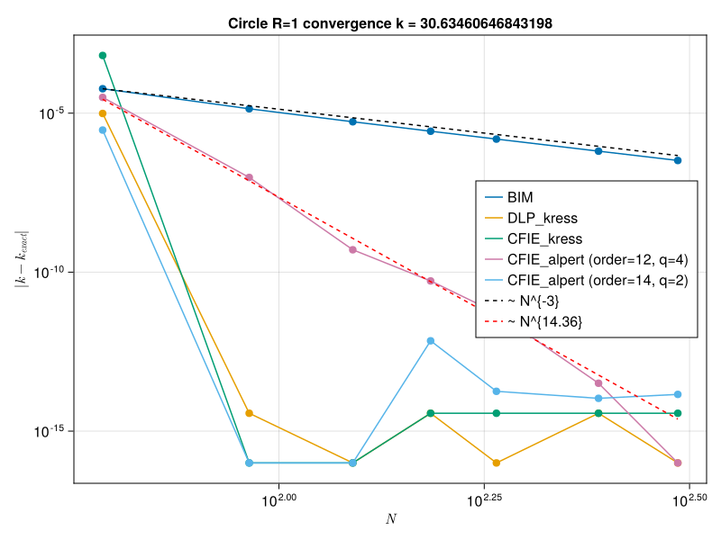
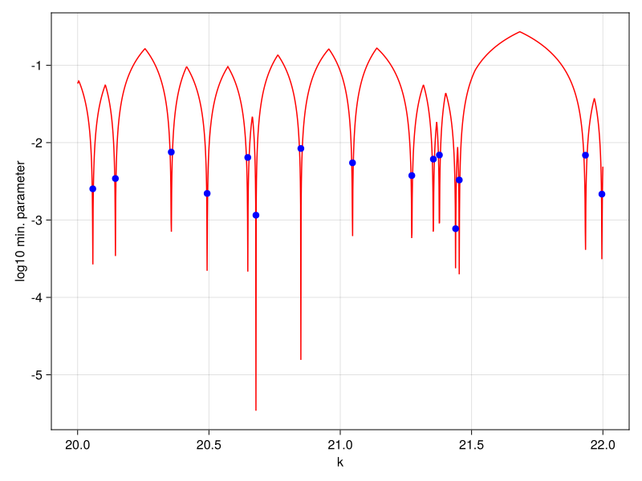
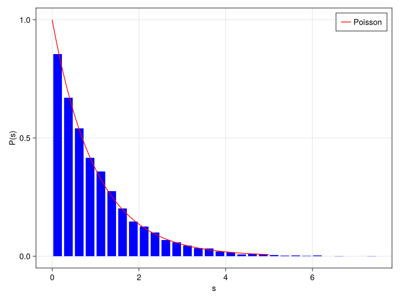
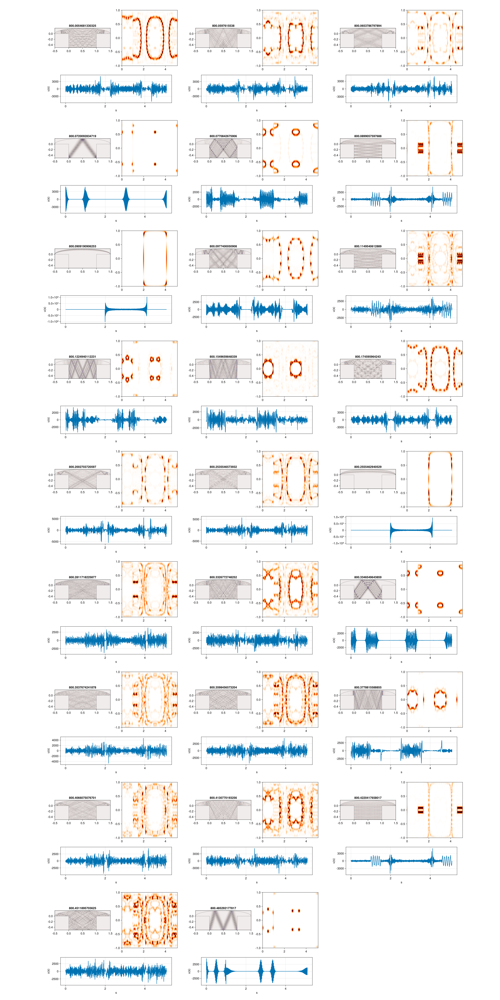
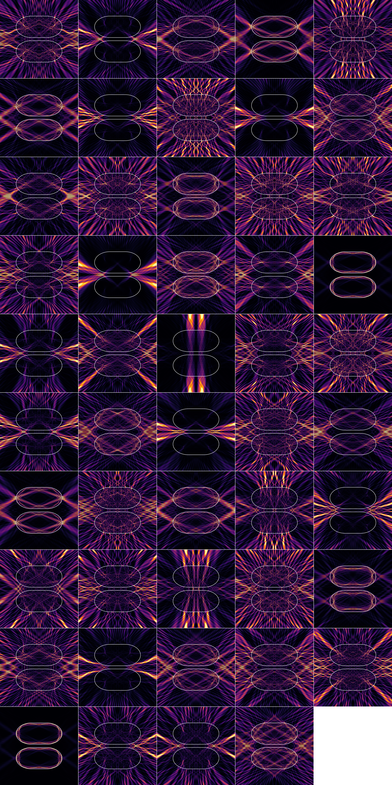
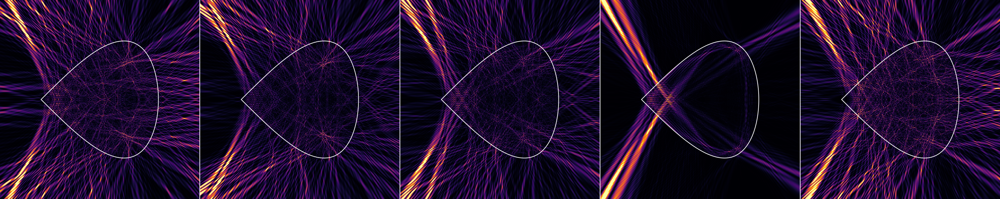

# QuantumBilliards.jl

A Julia library for computing eigenvalues, eigenfunctions and Husimi functions of 2D quantum billiards using boundary integral and basis-expansion methods.

**For now use Julia 1.19 due to CairoMakie issue**
**See examples folder for most common and practical uses of this library**
**See Quantum-Chaos-Julia/QuantumBilliards.jl for the paper**

This is just a fun dev version, has some advanced stuff currently unpublished (and unpushed to remote), some wrong stuff that I did not have time to fix yet (looking at you symmetries w/ Kress quad. scheme for non cheb route and hyperbol. symm., but next on the lists). Currently use at your own peril (if using the mentioned probs - still gives some result, just not accurate as symms for Kress dont work in the old naive way people used it - I fixed it in QB.jl). Rather, use the one in Quantum-Chaos-Julia/QuantumBilliards.jl, which is a more nicely designed port of this one with added stuff.

EDIT 4/11/26 Will add the OG Taylor recurrences for Beyn since it was made molded to work with Črt's BilliardGeometry.jl (but for dev-ing best to keep deps to minimum). This approach really cheap and maybe in future a good cheap way to make a poly of det(A(t)) will be implemented to extend L. Zhao and A. Barnett's approach via Nystrom discr. of A and det poly with Boyd root finding.

EDIT 4/11/26 Will add the OG CORK code when I have the time (Quantum-Chaos-Julia/QuantumBilliards.jl has the ver that works with Črt's BilliardGeometry.jl, but for dev-ing it is better to have the least deps as possible here). Fun fact: the OG reason why CORK was implemented is because of my problems with the Landau level remaining garbage after regularization by the Gamma reflection identity in Hornberger & Smilansky. Because CORK works on matrix poly we can divide out the poly coeffs corresponding to directions that are numerically vanishing (the garbage as hinted in the paper) so only physical sols remain (kind of hate this approach as it requires some QR-ing with cutoffs). Works but prefer Beyn with the V matrix with interior G evals to remove the garbage for magnetic case.

EDIT 4/11/26 For the Backer Y0 approach (described below) it is probably best to add the J0 (ala gauge field methods (GFM) (check {Cohen,Lepore,Heller} paper) with some real coupling to push the spurious roots further away from real ones for stability (prel. testing). Also to prevent large number of residual testing a probe matrix similar to the magnetic one described in our QB.jl paper is to be used - check spurious rejection trick!

Happy coding and cheers,
Matic

## Overview

- Boundary Integral Methods
    1. Boundary Integral Equations in time-harmonic acoustic scattering, Kress R., 1991
    2. (Habilitationsschrift) Eigenfunctions in chaotic quantum systems, Backer A., 2007
    3. HYBRID GAUSS-TRAPEZOIDAL QUADRATURE RULES, Alpert B., 1999 (LEGACY for Euclidian BIM)
    4. Gauss-Legendre log. product quad. - for those pesky geoms like stadium - C1 joins but no corners to naively grade
- Local accelerated solvers 
    1. Calculation by scaling of highly excited states of billiards, Vergini E., Saraceno M. 1995 https://pubmed.ncbi.nlm.nih.gov/9963660/
    2. (PhD thesis) https://users.flatironinstitute.org/~ahb/thesis_html/node71.html, Barnett A.
    3. Expanded boundary integral method and chaotic time-reversal doublets in quantum billiards, Veble et. al., 2006 https://arxiv.org/abs/nlin/0612011
- Contour methods (Beyn, TODO Cork)
    1. An integral method for solving nonlinear eigenvalue problems, Wolf-Jürgen Beyn, 2010 https://arxiv.org/abs/1003.1580
- Chebyshev-accelerated kernel assembly (LEGACY)
    1. Greengard's hank106.f code - idea for panelization implementation
- Dielectric cavities (done with some optimizations inplace, check examples folder. Rect. contour is king because side reuse and the binary search for svd cutoff drop is also king it seems (since no cheap im part trikc here like in interior resonances in tipical QBs))

Focus is on the balance between **performance** and **spectral resolution**, with a high-level API and low-level optimizations.

## Citing

If you use `QuantumBilliards.jl` in your research, please cite the ver Quantum-Chaos-Julia/QuantumBilliards.jl

---

## Methods

Easier to just check examples and let AI generate the scripts that call the API, if just a shorter doc then pointless to write...

## Typical Workflow

1. Define billiard -> billiard, basis = make_billiard_and_basis(...)
2. Choose solver -> geometry and problem dependant
3. Discretize boundary -> evaluate_points(...) (done internally)
4. Compute spectrum  -> compute_spectrum_beyn(...), compute_spectrum_ebim(...), compute_spectrum_with_state_data(...)
5. Plot wavefunctions or compute boundary functions (normal derivative of wavefunction on boudnary) for Husimi functions

! Check examples folder 

---

## Status

Active development focused on:
- integration into the QuantumChaosJulia ecosystem
    1. https://github.com/Quantum-Chaos-Julia/BilliardGeometry.jl
-   1. Reduce allocations in Beyn buffer matrices and temp matrices, we should just view into the largest k array matrix buffer.
-   1. lu! with HSS algorithm for Beyn since Fredholm matrix should have mature support 
-   1. Real Green's function kernel (as discussed by B\"acker:  (Habilitationsschrift) Eigenfunctions in chaotic quantum systems, Backer A., 2007, in the section on sources of spurious solutions) to halve the node count in Beyn with layer post-processing to get rid of extra spurious solutions.
    1. Relativistic Quantum Chaos in Neutrino Billiards, Dietz B. (https://arxiv.org/pdf/2604.13003)
- Hyperbolic kernel - Legendre Q via mpmath and seeding w/ Taylor series center expansion (Done, currently used in a paper, add after publication)  
- Fast computation of high frequency Dirichlet eigenmodes via the spectral flow of the interior Neumann-to-Dirichlet map, Barnett A., Hassell A. 2011 https://arxiv.org/abs/1112.5665
- QBX,QB2X (just maybe for near evals of weird kernels and wavefuncs near bdry, ubiqutous one is also interesting, but chunkie will prob have the better implementation)
    1. Quadrature by Expansion: A New Method for the Evaluation of Layer Potentials, Kl¨ockner A., Barnett A., Greendard L., O'Neil M. (https://arxiv.org/pdf/1207.4461)
    2. Quadrature by Two Expansions for Evaluating Helmholtz Layer Potentials, Weed J., Ding. L,... (https://arxiv.org/pdf/2207.13762)
- OTOC, wavepacket dynamics...

## Critical

Fix Evanescent Plane Waves, as currently the CompositeBasis does not work (if complex num. ver. of it will break real symm Eigen though for VS, bummer).

## Some pics...

NOTE: All of these are generate from .jl files inside examples/ folder

Convergence to an eigenvalue of the circle with R=1 for various BIE type solvers (DLP kress, CFIE kress, Alpert, naive DLP) showing spectral convergence for the Kress solvers and high order for Alpert along with O(1/N^3) for naive DLP.

Example k_sweep for the Prosen billiard (red line) with the solutions (blue dots) of ebim for the DLP_kress solver. Symmetry was set to nothing as this is what primarily Kress and Alpert solvers are meant for outside Beyn subspace projection.

Spectrum of the desymmetrized XYReflection(-1,-1) ellipse for k in [5,400] showing excellent agreement with Poisson. This is part of examples/example_spectrum.jl

Examples of the wavefucntions and husimis for the ellipse cap mushroom (XReflection(-1) symmetry) for k in [800.0,800.5] using the VerginiSaraceno scaling method. The regular region is very small and can be seen in a few subfigures where the wavefunction lives only in the cap. Also some MUPOs can be seen. The boundary function is purely real.

Examples of wavefunctions and PH functions for the star billiard desymmetrized with Rotation(5,0) (the real irrep) which was done via Beyn's subspace projection. Note that the imaginary part of the u(s) is 0, which is needed since that irrep has real eigenfunctions. In principle this can even be complex with just a global phase shift depending on the SVD conventions (Krylov solve_vect for adjint kernel gives it with a general global phase but it gives correct wavefunctions/PH functions - this pic was made with a slower gesvd call which had the global phase realification built in and returned the deshifted u(s), but this is just cosmetics for wavefunctions/PH functions.)

Examples of a domain with holes, restricted via Beyn's subspace projection to Reflection(-1,-1). It is an example of a mixed type system, where the outer high angular momentum nodes do not see the interior holes and behave like a regular circle billiard. Once it penetrates deeper into the billiard it disperses giving rise to nontrivial patterns with localization. The irrep is real, therefore the u(s) should be real. One can check that the resulting u(s) in the plots can be made real with a global phase shift (as can be seen from PH functions being symmetric p -> -p) 

Example of 2 stadiums with n_in=1.5 and outside having n_out=1.0 (:TM field) with XY reflection symmetry. Also the Kress teardrop with x axis reflection symmetry with -1 parity.
